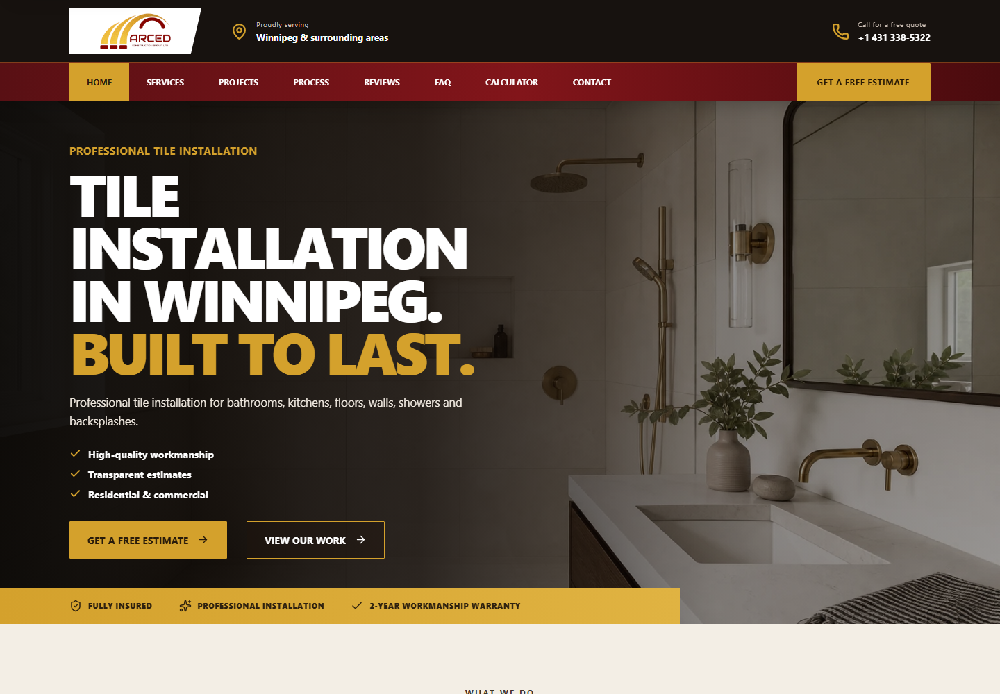
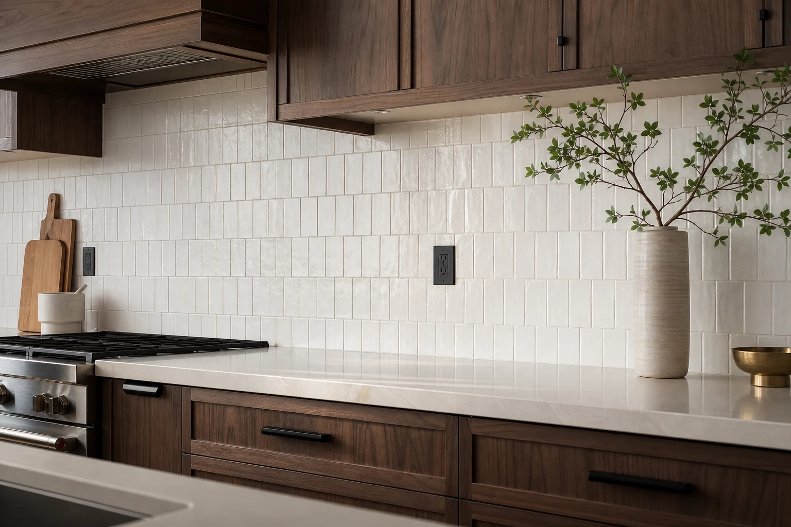
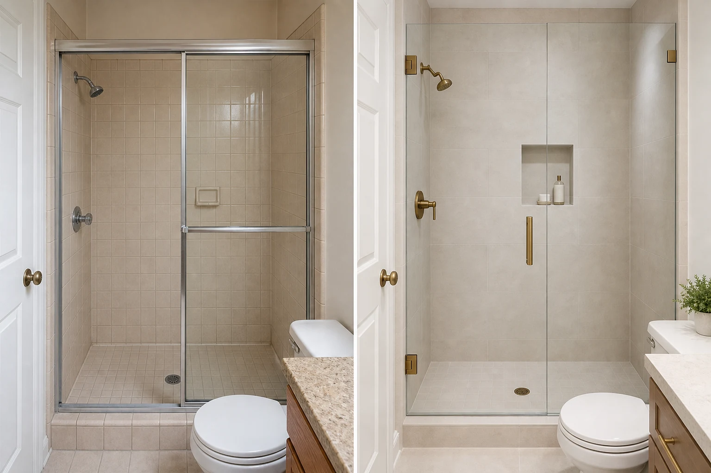

# ARCED Tile - Installation Services

A production React/Vite website for ARCED Tile, a Winnipeg tile installation and interior finishing service.

## Business Context

The site presents tile installation for bathrooms, showers, kitchens, backsplashes, floors, walls, residential renovations, and commercial interiors in Winnipeg and surrounding areas.

## My Role

Independent digital product designer and web developer responsible for the service presentation, responsive UX/UI, estimate flow, and implementation.

## Project Objectives

- Help visitors understand the available tile services.
- Make bathroom, kitchen, floor, shower, repair, and commercial work easy to compare.
- Support a clear customer enquiry path.
- Provide a preliminary project cost calculator with visible assumptions.
- Present the work clearly across desktop and mobile.

## UX/UI Approach

The information architecture follows the questions a customer is likely to have: what can be installed, how the work progresses, what preparation is involved, what a project may cost, and how to request an estimate. Service cards, project examples, FAQs, and the calculator create a practical path from discovery to enquiry without hiding the project variables that affect pricing.

## Website Functionality

- Tile installation services landing page.
- Bathroom, kitchen, backsplash, floor, wall, shower, repair, removal, and waterproofing content.
- Residential and commercial project presentation.
- Interactive preliminary tile project cost calculator.
- Contact and estimate enquiry form.
- FAQ content.
- Privacy Policy and Terms of Use pages.
- Review submission and review moderation routes backed by the project's server-side review handler.

The enquiry form uses the runtime-configured `VITE_FORMSPREE_ENDPOINT` when provided. No CRM integration is claimed in this repository.

## Verified Technology Stack

- React
- Vite
- JavaScript / JSX
- CSS
- lucide-react
- Vercel Functions for the reviews endpoint
- @vercel/blob dependency for server-side review storage

## Project Structure

```text
src/App.jsx                    Main page composition and content
src/calculatorData.js          Calculator options and pricing logic
src/components/                Header, footer, reviews, and shared UI
src/pages/                     Calculator, legal, and review-admin pages
src/seo.js                     Page metadata and structured data
src/styles.css                 Site styling
api/reviews.js                 Server-side review handler
public/assets/                 Logo and tile imagery
vercel.json                    Vercel configuration
```

## Local Development

```bash
pnpm install
pnpm dev
```

Create a production build with:

```bash
pnpm build
pnpm preview
```

The review and enquiry flows require their intended environment configuration. Do not commit production credentials.

## Live Website

https://arcedtile.ca

## Screenshots

The following screenshot was captured from the current production site.







## Project Status

Production site available and actively maintained. Runtime services such as form delivery and review storage depend on the configured deployment environment.

## Related Portfolio

https://yanaellis.com/commercial-case.html?id=arced

